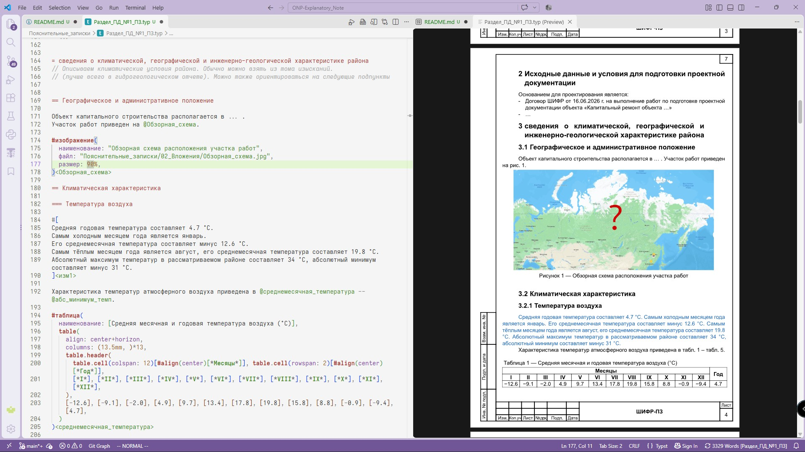
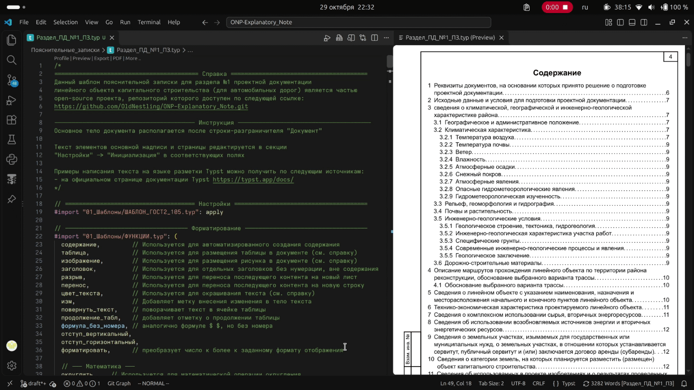
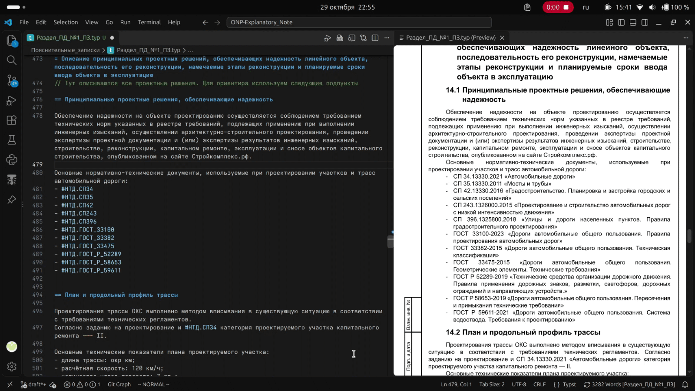

# ONP: Пояснительная записка

## О проекте

Данный проект разработан для автоматизации и упрощения формирования пояснительных записок проектной документации из одного исходного файлов в двух видах:

- PDF в соответствии с требованиями к оформлению по СПДС и ЕСКД;
- в XML в соответствии с XML-схемами от Минстроя.

Проект представляет собой технологический процесс из двух частей:

1. [Использование](#демонстрация) типографической системы верстки [Typst](https://github.com/typst/typst) в сочетании с готовым шаблоном оформления документов.
Данная технология предоставляет следующие преимущества:

   - Пользователь абстрагируется от требований стандартов оформления, ручной настройки стилей элементов пояснительной записки и полностью сосредотачивается на содержании;
   - Компилятор Typst автоматически применяет заданное шаблоном оформление, формирует содержание, нумерует изображения и таблицы, а также добавляет ссылки на все элементы в PDF;
   - Создание PDF-файлов занимает считанные секунды;
   - Легко внедрять переменные в текст, включая возможность использования данных из разных файлов, что снижает вероятность ошибок и разночтений;
   - Можно выполнять вычисления и расчёты прямо в файле, а также добавлять скрытые комментарии к тексту;
   - Удобно работать с разными версиями пояснительных записок, используя систему контроля версий Git;
   - Возможность доработать и настроить шаблоны и функции под себя.

2. Применение программы для преобразования исходного файла typst с пояснительной запиской в xml формат.
Текст, изображения и таблицы переносятся в соответствии с требованиями [xml-схемы](xml-schemas/01.07/explanatorynote-01-07.xsd) ([визуализация схемы](xml-schemas/01.07/Блок-Схема%2001.07.png)), после чего пользователю остаётся заполнить оставшиеся поля, которые нельзя было получить из текстовой части ввиду их отсутствия там.

> [!NOTE]
> Программа для конвертации и редактирования пояснительной записки находится в разработке.

И первый, и второй компонент доступны бесплатно в соответствии с [лицензией](#лицензия)

### Кому это может быть полезно

Данный проект может быть полезен тем, кто разрабатывает пояснительные записки для строительных проектов.
В первую очередь это касается проектировщиков из дорожно-строительной отрасли, так как разработка идёт в первую очередь под неё.

С учётом увеличения разделов, подлежащих представлению на государственную экспертизу в форматах XML, автор надеется, что общественность найдет данный проект полезным.

## Демонстрация

Использование глобальных переменных проекта:

Математика внутри текста:

## Использование

Для использования Typst в формировании пояснительных записок требуется установить следующие программы и их компоненты:

1. Компилятор Typst версии [0.15.0](https://github.com/typst/typst/releases/tag/v0.15.0)
(разработка программы идёт именно под эту версию)

2. Visual Studio Code (VSC) в качестве редактора и окна просмотра файлов `.typ` со следующими расширениями:

   - [Tinymist Typst](https://github.com/Myriad-Dreamin/tinymist) — языковой сервер typst;
   - [Typst Companion](https://github.com/CFiggers/typst-companion) — инструменты для упрощения взаимодействия с синтаксисом языка разметки (опционально);
   - [vscode-pdf](https://github.com/tomoki1207/vscode-pdfviewer) — для просмотра файлов PDF внутри VSC (опционально);
   - [Code Spell Checker](https://github.com/streetsidesoftware/vscode-spell-checker) в связке с [Russian - Code Spell Checker](https://github.com/streetsidesoftware/vscode-cspell-dict-extensions) для проверки орфографии (опционально).

Программа для конвертации исходного файла записки в xml-файл по схеме [версии 1.07](xml-schemas/01.07/explanatorynote-01-07.xsd) для автомобильных работ на данный момент находится в начале разработки.

## Лицензия

Эта программа является свободным программным обеспечением: вы можете распространять ее и/или вносить в нее изменения в соответствии с условиями Стандартной общественной лицензии GNU, опубликованной Free Software Foundation, либо версии 3, либо (по вашему выбору) любой более поздней версии.

 Эта программа распространяется в надежде, что она будет вам полезна, но БЕЗ КАКИХ-ЛИБО ГАРАНТИЙ, даже подразумеваемых гарантий ТОВАРНОГО СОСТОЯНИЯ или ПРИГОДНОСТИ ДЛЯ ИСПОЛЬЗОВАНИЯ В ОПРЕДЕЛЕННОЙ ЦЕЛИ.  Подробнее см. в Стандартной общественной лицензии GNU.

 Вместе с этой программой вы должны были получить копию Стандартной общественной лицензии GNU.  Если нет, см. <https://www.gnu.org/licenses/>.

 Полный текст используемых лицензий смотреть в файле [LICENSE](LICENSE)

## Развитие и поддержка

Связь с автором: <oldnestling@yandex.ru>

Материалы данного проекта распространяются бесплатно и разрабатываются на чистом энтузиазме.
Если вы находите этот проект полезным, вы можете поддержать (и мотивировать) автора по этому счёту:

[4081 7810 6000 9641 9718](https://www.tinkoff.ru/rm/r_aOqwUwfbRm.lZNlrKjSLm/oMI8k46003)

